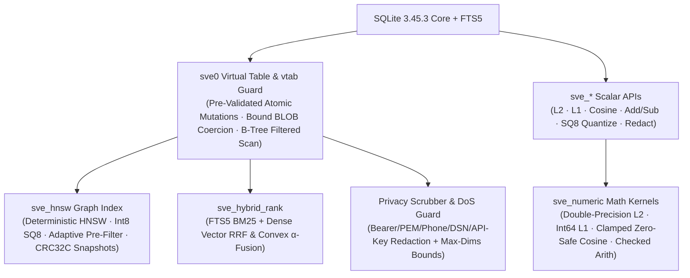

# sqlite-vec-hybrid (`sve0` + `sve_*`)

> [中文文档 (README.zh.md)](README.zh.md) · [Architecture](docs/DESIGN_ARCHITECTURE.md) · [Topic Proposal](docs/01_TOPIC_PROPOSAL.md) · [Benchmark JSON](docs/benchmarks_report.json) · [Audit report (Chinese)](docs/GPT_SOL_6_2_AUDIT_REPORT.md)

A pure-C11 hardened vector + native FTS5 hybrid search SQLite extension derived from unmodified [`asg017/sqlite-vec`](https://github.com/asg017/sqlite-vec) (`commit 04d28bd21773981e2d266bbf6aa4efbd011eb4f6`, `v0.1.10-alpha.4`). Runs 100% locally on CPU across Windows, Linux, and edge targets (Raspberry Pi / embedded SQLite hosts) with zero external servers or paid APIs.

Load the extension through the SQLite C API or shell `.load` on SQLite 3.45.0 or later. Writers use SVEH v2 and readers accept valid v1 snapshots.

---

## Architecture Overview



---

## Upstream Defects Reproduced & Fixed Side-by-Side

The repository keeps `upstream/sqlite-vec/` 100% untouched (`0` lines modified) so `test_upstream_repro` and `sve_hybrid_cli repro-compare` verify both engines head-to-head:

| Upstream Bug / Gap | Unmodified `vec0` / `vec_*` Baseline | Hardened `sve0` / `sve_*` Engine |
| :--- | :--- | :--- |
| **`#333` Explicit-Txn Ghost Row Leak** | Failed `INSERT` (`+code integer` constraint) leaves **1** searchable ghost row (`rowid=42`) | Pre-validates all constraints & vector bounds prior to shadow writes and journals the shadow writes to leave **0** ghost rows |
| **`#361` Untyped Bound `int8` BLOB Rejected** | Fails with `"expected to be of type int8, but a float32 vector was provided"` | Contextually coerces untyped `BLOB` parameters via column element type + byte length (`4B` `int8[4]` accepted) |
| **`#334` `L2` Overflow (`1e20`) & Underflow (`1e-25`)** | Accumulates `t*t` in `float32` -> returns **`inf`** and **`0`** | Accumulates in IEEE-754 `double` -> exact **`1e+20`** and **`1e-25`**, plus zero-norm safe cosine (`1.0`, never `NaN`) |
| **`#362` `int8` `L1` `INT32_MAX` Overflow** | Wraps in signed `i32` & `sqlite3_result_int` -> **`-2140217296`** at 8.45M dims | Accumulates into `int64_t` via `sqlite3_result_int64` -> exact **`2167500000`** at 8.5M dims |
| **`#363` `vec_add` Silent Modulo Wrap / `Inf` Emit** | Wraps `[100]+[50]` to **`[-106,-106]`** and emits non-finite `float32` | `sve_add` rejects overflows & non-finite results cleanly; `sve_add_sat` provides explicit saturation (`[127,-128]`) |

---

## Three-tier local CPU benchmark · PASS WITH WARNINGS

### Tier 1 · BEIR SciFact and NFCorpus (128 dimensions)

Positive test qrels define binary relevance. Dataset counts are documents / queries.

| Dataset | Mode | nDCG@10 | MRR@10 | Recall@10 | P50 (ms) | P99 (ms) |
| --- | --- | ---: | ---: | ---: | ---: | ---: |
| SciFact (5,183 / 300) | vec0 FLAT | 0.3815 | 0.3372 | 0.5336 | 1.7484 | 3.4474 |
| SciFact | sve0 FP32 HNSW | 0.3801 | 0.3364 | 0.5302 | 0.4933 | 0.9806 |
| SciFact | FTS5 BM25 | 0.6683 | 0.6348 | 0.7956 | 10.0900 | 39.1692 |
| SciFact | Hybrid RRF (constant 60) | 0.5401 | 0.5008 | 0.6938 | 10.1354 | 42.9128 |
| SciFact | Hybrid Convex (α=0.25) | 0.6714 | 0.6380 | 0.8024 | 10.2339 | 36.8949 |
| NFCorpus (3,633 / 323) | vec0 FLAT | 0.2429 | 0.3859 | 0.1126 | 1.3688 | 3.2338 |
| NFCorpus | sve0 FP32 HNSW | 0.2420 | 0.3828 | 0.1124 | 0.4875 | 1.1415 |
| NFCorpus | FTS5 BM25 | 0.3065 | 0.5124 | 0.1487 | 0.9037 | 10.0984 |
| NFCorpus | Hybrid RRF (constant 60) | 0.2843 | 0.4377 | 0.1521 | 1.4408 | 11.3301 |
| NFCorpus | Hybrid Convex (α=0.25) | 0.3240 | 0.5315 | 0.1658 | 1.4582 | 11.9077 |

### Tier 2 · 20K synthetic ANN benchmark

128 dimensions, seed 42, 200 queries, k=10. The 5% filter selects 1,000 rows.

| Mode | Build (ms) | P50 (ms) | P99 (ms) | P50 × | Recall@10 | Filtered P99 (ms) | Filtered Recall@10 |
| --- | ---: | ---: | ---: | ---: | ---: | ---: | ---: |
| vec0 FLAT | 116.29 | 3.1976 | 4.5165 | 1.00 | FLAT | 4.1088 | — |
| FP32 HNSW | 28770.15 | 0.4935 | 1.0906 | 6.48 | 0.9935 | 2.2687 | 1.0000 |
| SQ8 HNSW | 10645.04 | 0.3902 | 0.7724 | 8.19 | 0.9625 | — | — |

FP32 Recall@10 reached 0.9935. SQ8 scored 0.9625 against the 0.99 reference.

### Tier 3 · Fixed privacy fixtures

Detected secrets in 15/15 cases with 0/15 false positives.

---

## SQL Usage & Hybrid Queries

```sql
CREATE VIRTUAL TABLE docs USING sve0(
  emb float[128] index=hnsw metric=cosine m=16 ef_construction=100 ef_search=64,
  cat text,
  body text fulltext,
  redact=1
);

-- Hybrid Dense HNSW + FTS5 BM25 via Convex Fusion (or omit hybrid_alpha for RRF k=60)
SELECT rowid, cat, distance, rrf_score
FROM docs
WHERE emb MATCH '[...]'
  AND text_query MATCH 'thermal runaway mitigation'
  AND hybrid_alpha = 0.25
  AND cat = 'battery'
  AND k = 10;
```

---

## Cross-Compiler Build & Test Verification

| Compiler / Platform | Strict Flags | Static Lib + Loadable DLL (`vec_hybrid.dll`) + CLI | CTest Suite |
| :--- | :--- | :---: | :---: |
| **MSVC 19.50 (x64)** | `/W4 /WX /std:c11` | `0` warnings / `0` errors | **`38/38` PASSED** |
| **MinGW-W64 GCC 16.2.0** | `-std=c11 -Wall -Wextra -Wpedantic -Werror` | `0` warnings / `0` errors | **`38/38` PASSED** |

### Quick Build & Reproduction

```powershell
# Configure & build (MSVC or MinGW Makefiles)
cmake -S . -B build -DCMAKE_BUILD_TYPE=Release
cmake --build build -j 8
ctest --test-dir build --output-on-failure

# Reproduce Tier 2/3 & external BEIR Tier 1 benchmarks (pointing to external dataset dir)
python benchmarks/run_benchmarks.py --cli build/sve_hybrid_cli.exe --dataset-dir $env:SVE_BENCHMARK_DIR --output docs/benchmarks_report.json --dims 128
```
