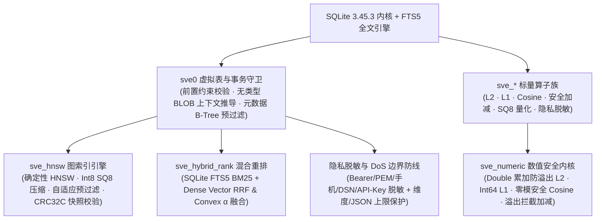

# sqlite-vec-hybrid（`sve0` + `sve_*`）

> [English README (README.md)](README.md) · [系统架构设计](docs/DESIGN_ARCHITECTURE.md) · [选题与缺陷分析](docs/01_TOPIC_PROPOSAL.md) · [三层基准数据](docs/benchmarks_report.json) · [审计报告](docs/GPT_SOL_6_2_AUDIT_REPORT.md)

基于未经任何源码修改的 [`asg017/sqlite-vec`](https://github.com/asg017/sqlite-vec)（`commit 04d28bd21773981e2d266bbf6aa4efbd011eb4f6`，`v0.1.10-alpha.4`）打造的 **纯 C11 高可靠 SQLite 向量索引与原生 FTS5 混合检索引擎**。零外部服务端依赖、零收费 API、100% 纯本地 CPU 运行，同时支持静态链接（`SQLITE_CORE`）与标准可动态加载扩展（`vec_hybrid.dll` / `.so`）。

可加载扩展使用 SQLite 3.45.0+，通过 SQLite C API 或 shell 的 `.load` 加载。新快照写为 SVEH v2，合法 v1 快照可读。

---

## 系统架构图



---

## 上游 5 类实测缺陷复现与同库对照修复

项目将未修改上游基线保留在 `upstream/sqlite-vec/`（`0` 行改动），通过 `test_upstream_repro` 与 `sve_hybrid_cli repro-compare` 同台验证修复效果：

| 上游缺陷 / 瓶颈 | 未修改 `vec0` / `vec_*` 基线表现 | `sve0` / `sve_*` 增强引擎表现 |
| :--- | :--- | :--- |
| **`#333` 显式事务插入失败残留幽灵行** | 写入失败（辅助列类型约束错误）后仍向 KNN 返回 **`1` 条幽灵行**（`rowid=42`） | 校验约束及向量后，在语句事务内写入影子表，残留 **`0` 条** |
| **`#361` 无 subtype 绑定 `int8` BLOB 遭误拒** | 绑定参数 `4B` 数据触发误报：`expected to be of type int8, but a float32 vector was provided` | 结合列元类型与字节长度进行上下文类型推导，无损接纳绑定 `int8` BLOB |
| **`#334` `L2` 溢出 `Infinity` 与下溢归零** | `float32` 累加 `t*t` 导致 `1e20` 溢出为 **`inf`**、`1e-25` 下溢为 **`0`** | IEEE-754 `double` 精确累加 -> **`1e+20`** 与 **`1e-25`**，且零向量 Cosine 安全返回 `1.0` |
| **`#362` `int8` `L1` 在 `INT32_MAX` 溢出负值** | `i32` 累加并经 `sqlite3_result_int` 截断，845 万维输出 **`-2140217296`** | `int64_t` 累加与 `sqlite3_result_int64` 输出，850 万维精准输出 **`2167500000`** |
| **`#363` `vec_add` 静默模回绕与 `Inf` 污染** | `[100]+[50]` 静默回绕为 **`[-106,-106]`**，浮点溢出静默写出 `Inf` | `sve_add` 严格拒绝溢出与非有限值；提供显式饱和版本 `sve_add_sat`（`[127,-128]`） |

---

## 三层本地 CPU 基准 · PASS WITH WARNINGS

### Tier 1 · BEIR SciFact / NFCorpus（128 维）

以公开测试 qrels 的正分定义二值相关性。表中括号为语料数 / 查询数。

| 数据集 | 模式 | nDCG@10 | MRR@10 | Recall@10 | P50 (ms) | P99 (ms) |
| --- | --- | ---: | ---: | ---: | ---: | ---: |
| SciFact（5,183 / 300） | vec0 FLAT | 0.3815 | 0.3372 | 0.5336 | 1.7484 | 3.4474 |
| SciFact | sve0 FP32 HNSW | 0.3801 | 0.3364 | 0.5302 | 0.4933 | 0.9806 |
| SciFact | FTS5 BM25 | 0.6683 | 0.6348 | 0.7956 | 10.0900 | 39.1692 |
| SciFact | 混合 RRF（融合常数 60） | 0.5401 | 0.5008 | 0.6938 | 10.1354 | 42.9128 |
| SciFact | 混合 Convex（α=0.25） | 0.6714 | 0.6380 | 0.8024 | 10.2339 | 36.8949 |
| NFCorpus（3,633 / 323） | vec0 FLAT | 0.2429 | 0.3859 | 0.1126 | 1.3688 | 3.2338 |
| NFCorpus | sve0 FP32 HNSW | 0.2420 | 0.3828 | 0.1124 | 0.4875 | 1.1415 |
| NFCorpus | FTS5 BM25 | 0.3065 | 0.5124 | 0.1487 | 0.9037 | 10.0984 |
| NFCorpus | 混合 RRF（融合常数 60） | 0.2843 | 0.4377 | 0.1521 | 1.4408 | 11.3301 |
| NFCorpus | 混合 Convex（α=0.25） | 0.3240 | 0.5315 | 0.1658 | 1.4582 | 11.9077 |

### Tier 2 · 20K 合成向量 ANN

128 维，种子 42，200 个查询，k=10。5% 过滤覆盖 1,000 条记录。

| 模式 | 构建 (ms) | P50 (ms) | P99 (ms) | P50 × | Recall@10 | 过滤 P99 (ms) | 过滤 Recall@10 |
| --- | ---: | ---: | ---: | ---: | ---: | ---: | ---: |
| vec0 FLAT | 116.29 | 3.1976 | 4.5165 | 1.00 | FLAT | 4.1088 | — |
| FP32 HNSW | 28770.15 | 0.4935 | 1.0906 | 6.48 | 0.9935 | 2.2687 | 1.0000 |
| SQ8 HNSW | 10645.04 | 0.3902 | 0.7724 | 8.19 | 0.9625 | — | — |

FP32 Recall@10 达到 0.9935。SQ8 Recall@10 为 0.9625，低于 0.99。

### Tier 3 · 固定隐私样本

敏感样本命中 15/15，良性样本误报 0/15。

---

## 跨编译器严苛构建矩阵

| 工具链 | 编译严格等级 | 编译交付物 | CTest 全量回归 |
| :--- | :--- | :--- | :---: |
| **MSVC 19.50 (x64)** | `/W4 /WX /std:c11` | `sve_hybrid.lib` + `vec_hybrid.dll` + `sve_hybrid_cli.exe` | **`38/38` PASSED** |
| **MinGW-W64 GCC 16.2.0** | `-std=c11 -Wall -Wextra -Wpedantic -Werror` | `libsve_hybrid.a` + `libvec_hybrid.dll` + `sve_hybrid_cli.exe` | **`38/38` PASSED** |

### 快速编译与基准复现命令

```powershell
cmake -S . -B build -DCMAKE_BUILD_TYPE=Release
cmake --build build -j 8
ctest --test-dir build --output-on-failure

python benchmarks/run_benchmarks.py --cli build/sve_hybrid_cli.exe --dataset-dir $env:SVE_BENCHMARK_DIR --output docs/benchmarks_report.json --dims 128
```
