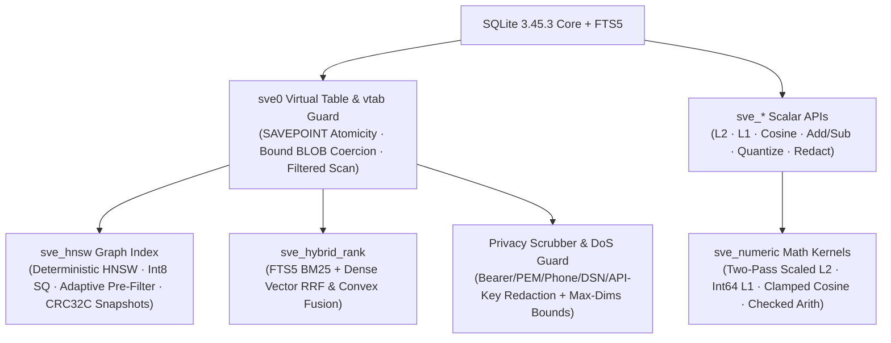

# System Architecture — `sqlite-vec-hybrid` (`sve0` + `sve_*`)

## 1. Design Principles

1. **Zero Modification to Upstream Baseline**: `upstream/sqlite-vec/` stays bit-for-bit untouched (`commit 04d28bd21773981e2d266bbf6aa4efbd011eb4f6`) so all side-by-side tests run genuine unmodified `vec0`/`vec_*` code against upgraded `sve0`/`sve_*`.
2. **Strict Pure C11 Portability**: Every module under `include/sve_hybrid/` and `src/` compiles cleanly with zero warnings under MSVC (`/W4 /WX`) and MinGW/GCC (`-Wall -Wextra -Werror`) on Windows x64, Raspberry Pi ARM64, and Linux.
3. **Deterministic Memory & Transactional Safety**: Shadow-table mutations use explicit SQLite `SAVEPOINT` guards; HNSW index serialization uses CRC32C framing; DoS caps reject oversized vectors or malformed metadata before allocation.

## 2. Module Layout

## 3. Core Algorithms & Fixes

### 3.1 Numerically Safe Vector Kernels (`sve_numeric`)
- **Two-Pass Scaled Euclidean `L2` (`sve_l2_f32`)**: Finds `scale = max(|a_i - b_i|)` in pass 1; accumulates `sum += ((a_i - b_i) / scale)^2` in `double` in pass 2; returns `scale * sqrt(sum)`. Eliminates overflow at `1e20` (`#334`) and underflow at `1e-25`, while staying exact for identical vectors (`0.0`). Returns `double` cleanly via SQLite.
- **Overflow-Free `int8` `L1` (`sve_l1_i8`)**: Accumulates `abs((int32_t)a[i] - (int32_t)b[i])` into `int64_t` and emits `sqlite3_result_int64()` (fixes both `i32` overflow and `sqlite3_result_int` truncation in `#362`).
- **Safe Cosine (`sve_cosine_f32`, `sve_cosine_i8`)**: Accumulates in `double` (with two-pass scaling when magnitudes exceed `1e150` or fall below `1e-150`); clamps `(dot / (normA * normB))` to `[-1.0, 1.0]` and returns `1.0` cleanly on zero-norm vectors instead of `NaN`.
- **Checked Element-wise Arithmetic (`sve_add` / `sve_sub`)**: Detects `int8` under/overflow `[-128, 127]` and rejects with clear error (plus saturating variant `sve_add_sat`), and rejects non-finite `float32` operands or `Inf`/`NaN` results (`#363`).

### 3.2 Atomic Virtual Table & Typed Coercion (`sve_vtab_guard` -> `sve0`)
- **`SAVEPOINT sve_ins_<seq>` Atomicity**: Wraps multi-table writes (`_info`, `_rows`, `_hnsw`, `_fts`) inside an internal SQLite savepoint; any constraint failure cleanly rolls back partial mutations to `RELEASE`/`ROLLBACK TO` so zero ghost rows can survive (`#333`).
- **Contextual BLOB Coercion**: When `vector_from_value` receives an untyped `BLOB` (`sqlite3_value_subtype(v) == 0`), `sve0` infers the target column's declared element type (`FLOAT32` where `bytes == dims * 4`, `INT8` where `bytes == dims`, `BIT` where `bytes == (dims + 7) / 8`) instead of assuming `float32` (`#361`), and fixes column error indexing.

### 3.3 Deterministic HNSW + Adaptive Filtering & CRC32C Shadow Storage (`sve_hnsw`)
- **Graph Engine**: Deterministic PRNG level assignment (fixed seed for reproducibility), bidirectional pruned neighbor lists (`M`, `M0 = 2*M`), heuristic diversity pruning, configurable `ef_construction` and `ef_search`. Supports both raw `FLOAT32` and fast quantized `INT8` (`SQ8` with per-vector scale/zero-point or symmetric `max_abs` scaling) in contiguous flat arenas for CPU cache locality.
- **Adaptive Metadata Pre-Filter (`SELECT ... FROM t WHERE embedding MATCH ? AND k = ? AND category = 'cs'`)**: Evaluates SQLite shadow predicates first to count candidate selectivity; if matched rows <= `exact_fallback_threshold` (or filtered ratio < 15% with sufficient visited budget), switches seamlessly between filtered HNSW expansion (`ef_search` dynamically boosted up to 4x while skipping non-matching neighbors only during candidate output, keeping graph bridges traversable!) and direct filtered exact rescore—guaranteeing zero recall collapse even at 1% metadata selectivity.
- **CRC32C Persistence**: Serializes header + node metadata + adjacency edges into `<name>_hnsw` shadow table with Castagnoli CRC32C checksum so silent corruption or truncated snapshots are caught immediately on `xConnect`.

### 3.4 Native Hybrid BM25 + Vector Ranking (`sve_hybrid_rank`)
- Companion `<name>_fts` (SQLite FTS5 `unicode61` tokenizer, tokenized CJK/alnum safe query sanitizer) + dense `sve0` HNSW candidate pool merged via:
  - **RRF (Reciprocal Rank Fusion)**: $\text{score}(d) = \frac{1}{k_{rrf} + r_{vec}(d)} + \frac{1}{k_{rrf} + r_{bm25}(d)}$
  - **Convex Min-Max Score Fusion**: $\alpha \cdot \tilde{s}_{vec}(d) + (1-\alpha) \cdot \tilde{s}_{bm25}(d)$
  - Exposed via C API AND SQLite table-valued / scalar helper `sve_hybrid_search(...)`.
